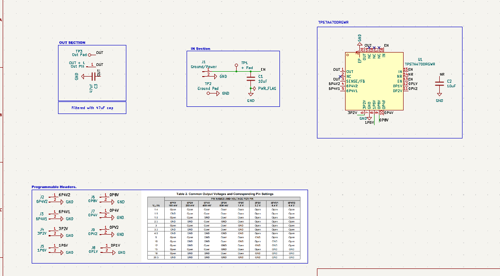
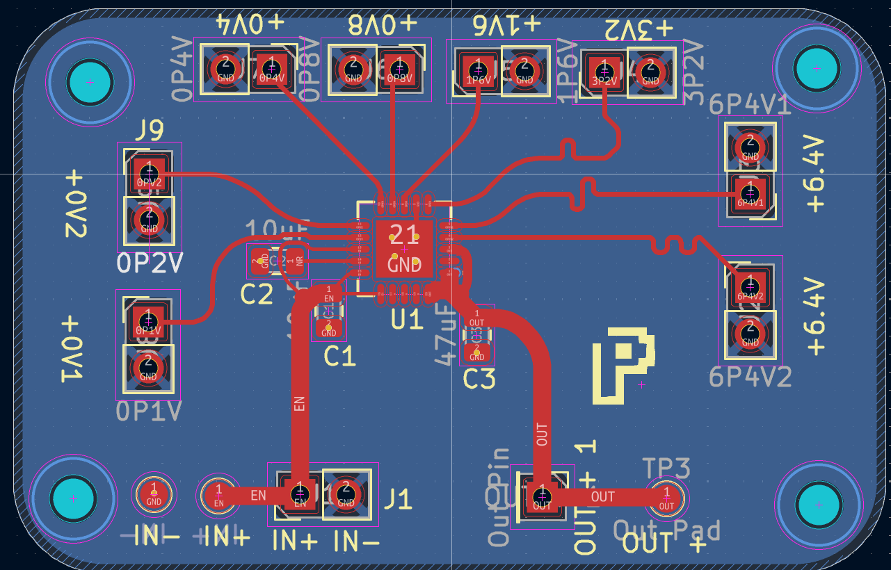
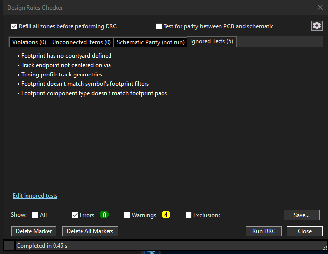
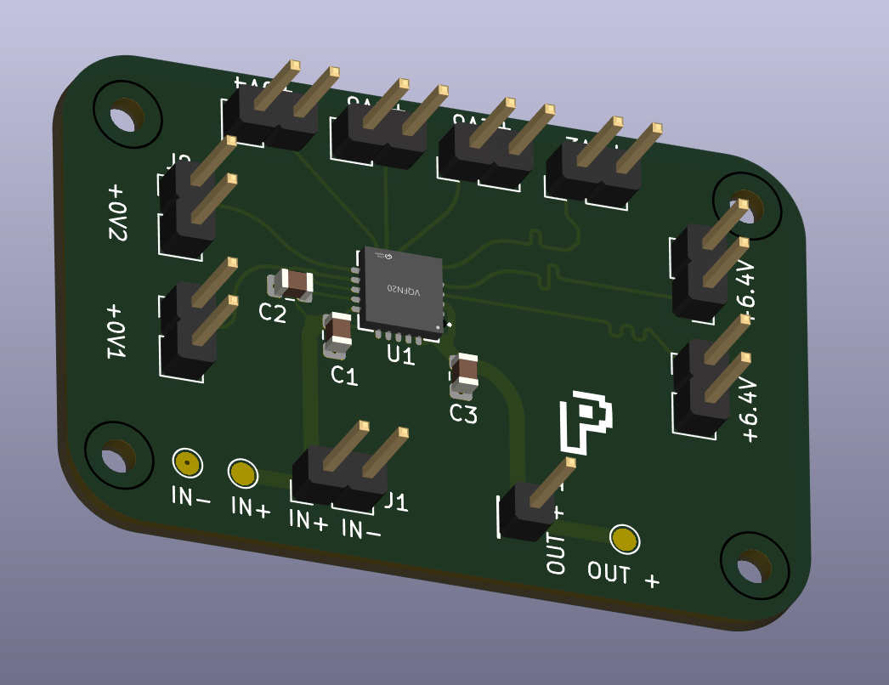

# TPS7A4700-step-down.

## 1. Project Overview 

This is an breakout board for TPS7A4700 module. 

### How it works?

This module contains several pins like 6V2,0V2,0V4.., when connected to GND it adds the respective voltage to the OUT.

### Why I built this?

When I was designing [FusionBoard](https://github.com/damnitzhemanth-oss/FusionBoard), I was really fascinated with this board. And I wanted to design a breakout board for this.

## 2. Specifications 

| Parameter | TPS7A4700 |
|---|---:|
| Device type | Positive high-voltage, ultralow-noise LDO linear regulator |
| Input voltage range | +3 V to +36 V |
| Recommended operating input voltage | 3.0 V to 35.0 V |
| Output voltage mode | ANY-OUT user-programmable via PCB layout |
| Output voltage range | +1.4 V to +20.5 V |
| Adjustable output mode | Not applicable |
| Output current | 1 A |
| Output voltage step size | 100 mV |
| Reference voltage | 1.4 V |
| Dropout voltage | 307 mV at 1 A |
| Output noise | 4 µV_RMS (10 Hz to 100 kHz) |
| PSRR | 82 dB at 100 Hz; ≥55 dB (10 Hz to 10 MHz) |
| Enable pin | CMOS logic-level compatible |
| Protection | Built-in fixed current limit and thermal shutdown |
| Thermal shutdown temperature | ~170°C shutdown; ~150°C reset |
| Operating junction temperature | -40°C to 125°C |
| Package | VQFN-20, 5 mm × 5 mm |

Checkout [Datasheet](Datasheets\TPS7A4700.pdf) for more details.

### Pin Setting

| Vo (V) | 0P1V<br>100 mV | 0P2V<br>200 mV | 0P4V<br>400 mV | 0P8V<br>800 mV | 1P6V<br>1.6 V | 3P2V<br>3.2 V | 6P4V1<br>6.4 V | 6P4V2<br>6.4 V |
| :---: | :---: | :---: | :---: | :---: | :---: | :---: | :---: | :---: |
| 1.4 | Open | Open | Open | Open | Open | Open | Open | Open |
| 1.5 | GND | Open | Open | Open | Open | Open | Open | Open |
| 1.8 | Open | Open | GND | Open | Open | Open | Open | Open |
| 2.5 | GND | GND | Open | GND | Open | Open | Open | Open |
| 3 | Open | Open | Open | Open | GND | Open | Open | Open |
| 3.3 | GND | GND | Open | Open | GND | Open | Open | Open |
| 4.5 | GND | GND | GND | GND | GND | Open | Open | Open |
| 5 | Open | Open | GND | Open | Open | GND | Open | Open |
| 10 | Open | GND | GND | Open | GND | Open | GND | Open |
| 12 | Open | GND | Open | GND | Open | GND | GND | Open |
| 15 | Open | Open | Open | GND | Open | Open | GND | GND |
| 18 | Open | GND | GND | Open | Open | GND | GND | GND |
| 20.5 | GND | GND | GND | GND | GND | GND | GND | GND |

## 3. Bill of Materials (BoM)

| Id | Designator | Footprint | Quantity | Designation | Supplier and ref |
|---|---|---|---|---|---|
| 1 | C1, C2 | C_0805_2012Metric | 2 | 10uF | |
| 2 | C3 | C_0805_2012Metric | 1 | 47uF | |
| 3 | J1 | PinHeader_1x02_P2.54mm_Vertical | 1 | Ground/Power | |
| 4 | J2 | PinHeader_1x02_P2.54mm_Vertical | 1 | 6P4V2 | |
| 5 | J3 | PinHeader_1x02_P2.54mm_Vertical | 1 | 6P4V1 | |
| 6 | J4 | PinHeader_1x02_P2.54mm_Vertical | 1 | 3P2V | |
| 7 | J5 | PinHeader_1x02_P2.54mm_Vertical | 1 | 1P6V | |
| 8 | J6 | PinHeader_1x02_P2.54mm_Vertical | 1 | 0P8V | |
| 9 | J7 | PinHeader_1x02_P2.54mm_Vertical | 1 | 0P4V | |
| 10 | J8 | PinHeader_1x02_P2.54mm_Vertical | 1 | 0P1V | |
| 11 | J9 | PinHeader_1x02_P2.54mm_Vertical | 1 | 0PV2 | |
| 12 | OUT + 1 | PinHeader_1x01_P2.54mm_Vertical | 1 | Out Pin | |
| 13 | TP1 | TestPoint_Pad_D1.5mm | 1 | + Pad | |
| 14 | TP2 | TestPoint_Pad_D1.5mm | 1 | Ground Pad | |
| 15 | TP3 | TestPoint_Pad_D1.5mm | 1 | Out Pad | |
| 16 | U1 | VQFN-20_L5.0-W5.0-P0.65-TL-EP | 1 | TPS7A4700RGWR | |

Check [Interactive-BOM](Production\BOM\ibom.html) for more insights.

## 4. Repo Navigation

```
TPS7A4700-step-down
├── CAD
│   └── STEP_DOWN.step
├── Datasheets
│   └── TPS7A4700.pdf
├── Images
│   ├── DRC.png
│   ├── PCB3D.png
│   ├── PCB_H.png
│   └── Pin_Settings.png
├── LICENSE
├── Production
│   ├── BOM
│   │   ├── STEP_DOWN.csv
│   │   └── ibom.html
│   ├── Gerbers
│   │   ├── STEP_DOWN_47.99x31.08mm_for_Default.zip
│   │   ├── STEP_DOWN_47.99x31.08mm_for_Elecrow.zip
│   │   ├── STEP_DOWN_47.99x31.08mm_for_FusionPCB.zip
│   │   ├── STEP_DOWN_47.99x31.08mm_for_JLCPCB.zip
│   │   └── STEP_DOWN_47.99x31.08mm_for_PCBWay.zip
│   └── STEP_DOWN-all-pos.csv
├── README.md
└── STEP_DOWN
    ├── STEP_DOWN.kicad_pcb
    ├── STEP_DOWN.kicad_pro
    └── STEP_DOWN.kicad_sch
```

## 5. Credits 

- [KiCad](https://www.google.com/url?opi=89978449&q=https://www.kicad.org/&sa=U&ved=2ahUKEwimlZP32eWXAxW-jOEIHdIBCzUQFnoECBEQAQ&usg=AOvVaw3RWTRyOBHwgJWf9Tp2GrV8), used as cad.
- [easyeda2kicad](https://github.com/BiggiePete/easyeda2kicad-App) extension for downloading footprint,symbols, 3d models.
- Interactive BOM Plugin.
- Round Corners Plugin.

## 7. Gallery

### PCB 





### 3D

